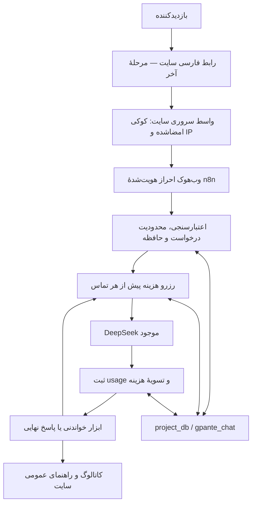

# دستیار پشتیبانی هوش مصنوعی جی‌پانته

دستیار فارسی [gpante.com](https://gpante.com) برای پیدا کردن طرح‌های برش لیزر، خواندن مشخصات و قیمت جاری و راهنمایی عمومی خرید و دانلود. هدف، محصول قابل توسعه روی n8n و PostgreSQL موجود است؛ همهٔ محصولات مجاز عمومی در دامنهٔ جست‌وجو قرار دارند و محدودیت ۳۰ یا ۵۰ محصول وجود ندارد.

**وضعیت در ۱۹ اکتبر ۲۰۲۶:** نسخهٔ ۱٫۱٫۰ به‌صورت پیش‌نویس غیرفعال در n8n ثبت شده است. مدل واقعی DeepSeek، حافظهٔ چندنوبتی و جداسازی نشست‌ها آزموده شده‌اند. چت روی سایت منتشر نشده؛ اتصال سایت با کد و بدون نصب افزونه، طبق تصمیم کاربر مرحلهٔ آخر است.

## دستیار چه کاری انجام می‌دهد؟

- موضوع، فرمت، ضخامت و متریال را با هم جست‌وجو می‌کند؛ مثلاً «باکس آجیل MDF، ضخامت ۲٫۷، فرمت DXF».
- برای «ارزان‌ترش را داری؟» شرایط همان گفتگو را نگه می‌دارد و ترتیب قیمت را از منبع درخواست می‌کند.
- مشخصات و قیمت را از دادهٔ جاری می‌خواند؛ ویژگی ناموجود را حدس نمی‌زند. قیمت صفر معتبر و واحد پول از منبع است.
- مقاله‌ها و صفحات عمومی قوانین و تماس را با لینک منبع ارائه می‌کند.
- نبود نتیجه، شکست ارتباط و اطلاعات ناقص را جدا می‌کند؛ بدون اجازهٔ کاربر فیلترها را حذف نمی‌کند.

پاسخ هر صفحه حداکثر پنج محصول است؛ این اندازهٔ نمایش است، نه سقف کاتالوگ. تعداد کل، صفحه و وجود ادامه در خروجی ابزار باقی می‌مانند. پوشش کامل منبع با کیفیت جست‌وجوی معنایی یکی نیست؛ embeddings یا سرویس تازه فقط در صورت مشاهدهٔ نیاز اضافه می‌شود.

## اجزای پروژه

| جزء | وضعیت و نقش |
| --- | --- |
| [Main در n8n](https://n8n.gpantex.com/workflow/5xu2B0aFF6EYFq2y) | ورک‌فلوی اصلی، پیش‌نویس غیرفعال و بدون نسخهٔ منتشرشده |
| DeepSeek موجود | همان اتصال انتخاب‌شدهٔ کاربر؛ فراخوانی از HTTP Request بومی با Credentials سروری |
| PostgreSQL پروژه‌ها | حافظه، محدودیت درخواست و دفتر هزینه فقط در `project_db.gpante_chat` |
| دیتابیس داخلی n8n | فقط امور خود n8n؛ schema چت در آن ایجاد نشده |
| Retention | ورک‌فلوی پاک‌سازی ساعتی، به‌صورت پیش‌نویس غیرفعال ثبت شده؛ پیش از ورود مشتری باید زمان‌بندی فعال شود |
| کد اتصال سایت | [integration/wordpress](integration/wordpress/README.md)، آمادهٔ بررسی محلی و موکول به مرحلهٔ نهایی؛ روی سایت اجرا نشده |
| مهارت نگهداری | [operate-gpante-support-chat](.agents/skills/operate-gpante-support-chat/SKILL.md)، نسخهٔ ۰٫۳٫۰ |

سامانهٔ جداگانهٔ `woo2` برای انتشار محصول است. چت عمومی به ابزارهای مدیریت، تلگرام، Nextcloud، بارگذاری فایل یا state آن سامانه متصل نیست.

## معماری نسخهٔ ۱٫۱



مدل URL، SQL یا کد دلخواه نمی‌دهد. فقط نام ابزار و پارامترهای محدود را درخواست می‌کند. مقصدها، شرایط عمومی‌بودن و پاک‌سازی خروجی در کد تعیین می‌شوند. حداکثر چهار تماس مدل و سه ابزار ترتیبی در هر پیام قابل اجراست؛ تماس آخر فقط پاسخ می‌دهد. هر تماس retry خودکار ندارد.

نسخهٔ اولیه از Agent بومی استفاده می‌کرد و آزمون واقعی آن موفق بود. مسیر HTTP بومی برای دسترسی روشن به `usage` هر تماس و اعمال بودجه انتخاب شد؛ کلید موجود خوانده یا عوض نشده است. مدل، ابزارها، رابط و حافظه منابع جدا دارند تا تغییر آینده محدود بماند.

## هزینه و ظرفیت

بودجهٔ تأییدشده **۲ دلار آمریکا در هر ماه تقویمی UTC برای همین پروژه** است. این سقف، مصرف پروژه‌های دیگر با کلید مشترک DeepSeek را محدود نمی‌کند.

قبل از هر تماس، ۰٫۳۲ دلار به‌صورت اتمی رزرو می‌شود. این رقم از بیش‌برآورد کل context مدل و سقف خروجی ۱۵۳۶ توکن با تعرفهٔ اوج ۱۹ اکتبر محاسبه شده است. پس از پاسخ معتبر، هزینه از `prompt_tokens` و `completion_tokens` با نرخ اوج بدون تخفیف cache ثبت و مازاد رزرو آزاد می‌شود. timeout یا usage نامشخص، رزرو را نگه می‌دارد؛ انقضای درخواست پول را آزاد نمی‌کند. محاسبه در دیتابیس با عدد صحیح نانودلار است.

اگر کمتر از ۰٫۳۲ دلار باقی بماند، تماس تازه پذیرفته نمی‌شود؛ بنابراین ممکن است بخشی از دو دلار استفاده نشود. این دفتر هزینه محافظه‌کارانه است و لزوماً برابر صورتحساب تخفیف‌دار ارائه‌دهنده نیست. [تعرفهٔ رسمی DeepSeek](https://api-docs.deepseek.com/quick_start/pricing/) باید پیش از تمدید اعتبار نرخ دوباره بررسی شود؛ اعتبار فعلی نرخ تا ۱۸ نوامبر ۲۰۲۶ است و پس از آن تماس تازه متوقف می‌شود.

پیش‌فرض ظرفیت تا زمان اندازه‌گیری ترافیک واقعی: دو درخواست هم‌زمان سراسری، یک درخواست فعال برای هر نشست، شش پیام در دقیقه برای هر شناسهٔ IP و ۳۰ عملیات در دقیقه برای همان شناسه. این‌ها ظرفیت تضمین‌شده یا تعداد کاربر برآوردشده نیستند. پیام حداکثر ۴۰۰۰ نویسه و اجرای ورک‌فلو حداکثر ۱۵۰ ثانیه است.

## گفتگو، حریم خصوصی و اعتماد

- تاریخچه تا **۳۰ روز** قابل خواندن است؛ حداکثر شش نوبت اخیر وارد زمینهٔ مدل می‌شود.
- حذف فیزیکی تاریخچه با پاک‌سازی ساعتی طراحی شده؛ در شرایط عادی می‌تواند تا یک ساعت پس از انقضا انجام شود. زمان‌بندی پیش از انتشار عمومی باید فعال و بررسی شود.
- کد رابط، پاک‌کردن صریح تاریخچهٔ همان نشست را دارد. حذف با درخواست فعال همان نشست هم‌زمان نمی‌شود.
- نشست مرورگر باید از کوکی امضاشدهٔ HttpOnly/Secure/SameSite ساخته شود؛ شناسهٔ دلخواه مرورگر مجوز خواندن گفتگو نیست.
- IP از سرور سایت گرفته و با HMAC تبدیل می‌شود. اعتماد به پراکسی و `REMOTE_ADDR` پیش از اتصال واقعی بررسی خواهد شد؛ هدر دلخواه مرورگر معتبر نیست.
- مرورگر کلید n8n را نمی‌گیرد. CORS جای احراز هویت یا محدودیت مصرف نیست.
- محتوای اجرای خام موفق، ناموفق و دستی در تنظیمات ورک‌فلو ذخیره نمی‌شود. تاریخچهٔ کاربردی در دیتابیس پروژه‌هاست.
- فایل‌های خصوصی، لینک دانلود فروشی، اطلاعات مشتری و کلیدها وارد مخزن عمومی یا خروجی ابزار نمی‌شوند.

## منبع کاتالوگ

منبع اولیهٔ عمومی Store API به‌صورت خواندنی آزموده شد: ۱۰۸۱ محصول گزارش شد و جست‌وجوی ترکیبی نمونه، هفت نتیجه در دو صفحهٔ بدون تکرار داشت. این‌ها مشاهدهٔ همان زمان‌اند، نه شمار ثابت آینده یا اثبات تک‌تک محصولات.

کد نسخهٔ ۱٫۱ دو مسیر محدود `gpante-support/v1/products` و `gpante-support/v1/knowledge` را برای اجرای سروری در سایت آماده می‌کند. محصول باید منتشرشده، بدون رمز و مجاز برای نمایش در کاتالوگ یا جست‌وجو باشد؛ visible، catalog-only و search-only پذیرفته می‌شوند و hidden/خصوصی/رمزدار رد می‌شوند. خواندن مستقیم جزئیات نیز همین شرایط را رعایت می‌کند. API قدیمی به‌تنهایی شاهد کافی برای حذف همهٔ موارد رمزدار نبود.

ویژگی‌های ساختاریافتهٔ WooCommerce شامل `pa_file-format`، `pa_thickness` و `pa_materials-required` هستند. اعداد و حروف فارسی/عربی یکسان می‌شوند. مترادف کنترل‌شدهٔ جعبه/باکس و term واقعی «MDF یا پلکسی» پشتیبانی می‌شوند؛ «MDF و پلکسی» خودکار به MDF ساده تبدیل نمی‌شود. ترتیب قیمت از lookup بومی WooCommerce درخواست می‌شود.

**این provider هنوز روی وردپرس اجرا نشده است.** تطبیق با نسخهٔ واقعی WooCommerce، صفحه‌بندی و حذف/تغییر visibility، قیمت و کارایی جست‌وجو، بخشی از آزمون مرحلهٔ نهایی‌اند. در نبود منبع، ورک‌فلو باید ناتوانی خواندن را اعلام کند؛ محصول یا سیاست خرید اختراع نمی‌کند.

## ساخت و بررسی برای توسعه‌دهنده

- `src/catalog.cjs`: قرارداد و پاک‌سازی ابزارهای عمومی.
- `src/chat.cjs` و `src/system-message.txt`: کنترل گفتگو، تماس مدل و دستورهای دستیار.
- `scripts/build-workflow.cjs`: ساخت قطعی JSONهای `workflows/`؛ بدون شناسهٔ استقرار، اتصال یا کلید خصوصی.
- `sql/chat.sql`: migration اولیه؛ روی schema موجود دوباره اجرا نشود.
- `sql/002-public-chat.sql`: ارتقای کنترل بودجه و نگهداری؛ یک‌بار پس از migration اولیه.
- `tests/database.sql`: بررسی تراکنشی با rollback؛ فقط وقتی Main غیرفعال است اجرا شود.

```sh
node --test tests/*.test.cjs
node scripts/build-workflow.cjs
php -l integration/wordpress/bridge.php
php -l integration/wordpress/catalog.php
php tests/widget-bridge.php
php tests/catalog-query.php
```

اعتبارسنج `scripts/validate-native.cjs` باید با Node و وابستگی‌های n8n نصب‌شده و یک کپی خصوصیِ دارای اتصال اجرا شود. فایل عمومی عمداً Credentials ندارد. نتیجهٔ exit code به‌تنهایی موفقیت اجرای CLI را ثابت نمی‌کند؛ `status` و خطاهای نتیجه نیز بررسی شوند.

آزمون واقعی تا این مرحله: Agent اولیه دو تماس موفق با راهنمای واقعی داشت؛ مسیر جدید در چهار سناریوی واقعی، ادامهٔ مکالمه، جداسازی نشست و اعلام خطای منبع را گذراند. در مجموع هفت تماس مدل، حدود **۰٫۰۰۴۴۸۱ دلار** هزینهٔ محافظه‌کارانه در دفتر پروژه ثبت کردند. زمان اجرای سناریوهای جدید حدود ۶ تا ۱۱ ثانیه بود؛ این عدد تضمین سرعت تولید یا نتیجهٔ آزمون بار نیست.

آزمون نهایی شامل ۳۵ تست Node، آزمون PHP پل سروری و هشت حالت callback کاتالوگ با query/Schema مصنوعی بود. رزرو هم‌زمان در مرز بودجه و جداسازی ماه نیز بدون تماس مدل بررسی شد؛ `tests/money-concurrency.py` فقط هنگام غیرفعال‌بودن Main و با کاربر نگهداری دیتابیس اجرا شود. گراف کامل چهار دور/سه ابزار با پاسخ‌های مصنوعی شبکه و PostgreSQL واقعی موفق بود. این‌ها جای آزمون سایت واقعی نیستند.

## مسیر تکمیل و توسعهٔ بعدی

مرحلهٔ باقی‌ماندهٔ اتصال عمومی: اجرای کد سروری سایت بدون نصب افزونه، آزمون واقعی provider و پاسخ‌های محصول، رابط موبایل/دسکتاپ، پراکسی و کوکی/cache، فعال‌کردن زمان‌بندی حذف و سپس انتشار نسخهٔ بررسی‌شدهٔ n8n. تأیید ساختاری و تست محلی به معنی آمادگی عمومی نیست.

بعد از هستهٔ عمومی می‌توان پیگیری سفارش، دانلود خریداری‌شده و ارجاع انسانی را با احراز هویت واقعی مشتری و کنترل مالکیت اضافه کرد. این نسخه به حساب، سفارش یا دانلود اختصاصی مشتری دسترسی ندارد و اقدام مالی یا تغییر سفارش انجام نمی‌دهد.

برای ادامهٔ کار، [AGENTS.md](AGENTS.md) و [مهارت اختصاصی](.agents/skills/operate-gpante-support-chat/SKILL.md) را بخوانید. [وضعیت جاری](.agents/skills/operate-gpante-support-chat/references/project-state.md) نسخهٔ واقعی n8n، نتیجهٔ بررسی‌ها و کار بعدی را ثبت می‌کند؛ Git تاریخچهٔ تغییرات است. هیچ نسخهٔ عمومی جای پشتیبان خصوصیِ قابل بازیابی و بازخوانی وضعیت زنده را نمی‌گیرد.
