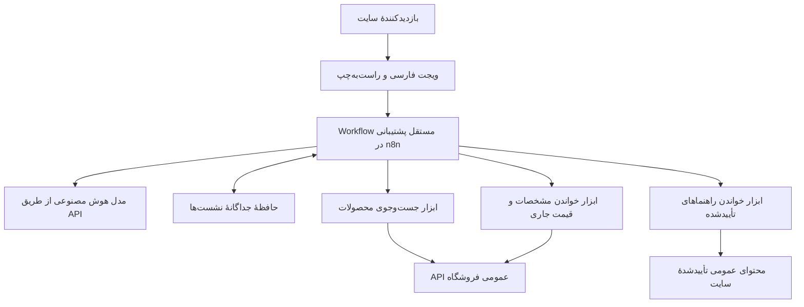

# دستیار پشتیبانی هوش مصنوعی جی‌پانته

پروژهٔ طراحی و راه‌اندازی دستیار فارسی سایت [gpante.com](https://gpante.com)، با استفاده از n8n موجود و مدل هوش مصنوعی از طریق API.

هدف این است که بازدیدکننده بتواند با زبان معمولی محصول مناسب پیدا کند، مشخصات فایل را بپرسد و برای خرید و دانلود راهنمایی بگیرد. دستیار در یک پنجرهٔ شناور روی سایت نمایش داده خواهد شد و مسیر توسعهٔ آن برای پشتیبانی پس از خرید نیز در نظر گرفته می‌شود.

> **وضعیت پروژه: زیرساخت بررسی شده و مهارت نگهداری پروژه ایجاد شده است؛ پیاده‌سازی چت سایت هنوز آغاز نشده است.**
>
> تاریخ بررسی مبنا: ۱۹ اکتبر ۲۰۲۶. معماری و مراحل توسعهٔ این سند پیشنهاد طراحی هستند، مگر آنکه صریحاً به‌عنوان نتیجهٔ آزمایش یا قابلیت پیاده‌سازی‌شده معرفی شوند.

## هدف و محدودیت‌ها

- ارائهٔ تجربهٔ فارسی، راست‌به‌چپ و هماهنگ با ظاهر سایت.
- پیشنهاد محصول بر اساس اطلاعات واقعی فروشگاه، شامل موضوع، فرمت، ضخامت، متریال و ابعاد.
- ارائهٔ لینک معتبر و خواندن قیمت و وضعیت فروش هنگام پیشنهاد محصول.
- راهنمایی کاربر با تکیه بر مقاله‌ها و راهنماهای تأییدشده.
- شروع با زیرساخت موجود و افزودن سرویس‌های دیگر بر اساس نیاز اندازه‌گیری‌شده.
- نداشتن هزینهٔ لایسنس افزونه یا اشتراک پلتفرم چت؛ هزینهٔ مصرف API مدل قابل قبول است.
- حفظ گردش‌کارهای موجود سرور و جلوگیری از اختلال در انتشار محصولات.
- فراهم‌کردن امکان افزودن قابلیت‌های بعدی بدون بازنویسی کل سامانه.
- پوشش کل کاتالوگ مجاز عمومی، بدون محدودیت تعداد محصول برای یک نسخهٔ نمایشی.

## وضعیت فعلی

| بخش | وضعیت |
| --- | --- |
| سایت | مبتنی بر WordPress و WooCommerce؛ روی سروری جدا از n8n |
| زیرساخت n8n | در دسترس و به‌صورت خواندنی بررسی شده |
| ارتباط با فروشگاه | دریافت محصول، جست‌وجو و ترکیب فیلترهای عمومی از داخل کانتینر n8n آزمایش شده |
| مقاله‌های عمومی | دریافت از WordPress REST API آزمایش شده |
| Workflow اختصاصی پشتیبانی سایت | ساخته یا منتشر نشده |
| مدل چت سایت | انتخاب نهایی و آزمایش اختصاصی انجام نشده |
| ویجت سایت | نصب و منتشر نشده |
| حافظهٔ نشست و پایگاه دانش چت | ایجاد نشده |
| مهارت اختصاصی نگهداری پروژه | نسخهٔ ۰٫۱٫۰ ایجاد شده؛ منبع آن در همین مخزن است |

مخزن شامل README، راهنمای عامل و مهارت اختصاصی نگهداری است. Workflow اجرایی چت و راهنمای استقرار محصول هنوز ایجاد نشده‌اند. آماده‌بودن مهارت، به معنی آماده‌بودن چت برای مشتری نیست.

روی سرور، سامانهٔ عملیاتی دیگری با نام `woo2` برای مدیریت و انتشار محصول وجود دارد. چت مدیریتی تلگرام آن، چت عمومی این پروژه نیست. دستیار سایت باید Workflow مستقلی داشته باشد و ابزارهای مدیریتی و انتشار محصول آن سامانه را در اختیار کاربران عمومی قرار ندهد.

## تجربهٔ مورد انتظار کاربر

### پیدا کردن محصول

کاربر می‌پرسد:

> یه باکس آجیل برای MDF با ضخامت ۲٫۷ می‌خوام که فایل DXF داشته باشه.

دستیار موضوع و ویژگی‌ها را استخراج می‌کند و محصولاتی را پیشنهاد می‌دهد که با شرایط خواسته‌شده تطابق دارند. پاسخ باید توضیح کوتاه و لینک محصول داشته باشد. نمایش تصویر و قیمت در ویجت نیز باید در آزمایش رابط کاربری بررسی شود.

اگر نتیجه‌ای وجود نداشت، دستیار باید این موضوع را روشن بگوید و برای تغییر شرایط از کاربر سؤال کند. تغییر خودسرانهٔ ضخامت، متریال یا فرمت مجاز نیست.

### ادامهٔ مکالمه

کاربر بعد از دیدن چند محصول می‌پرسد:

> ارزون‌ترش رو داری؟

دستیار باید شرایط قبلی مانند MDF، ضخامت ۲٫۷ و DXF را در همان نشست حفظ کند و درخواست جدید را بر اساس آن‌ها بررسی کند.

### پرسیدن مشخصات

کاربر می‌پرسد:

> ابعاد این مدل چقدره؟ فایل کورل هم داره؟

پاسخ باید از مشخصات همان محصول استخراج شود. اطلاعات ثبت‌نشده باید نامشخص اعلام شود؛ عنوان یا تصویر محصول به‌تنهایی مبنای حدس‌زدن مشخصات نیست.

### راهنمای خرید و دانلود

پرسش‌های عمومی مانند روش خرید، محل دریافت فایل و استفاده از راهنماها، با محتوای تأییدشده پاسخ داده می‌شوند. مشاهدهٔ سفارش یا ارائهٔ دانلود اختصاصی مشتری، به مرحلهٔ احراز هویت تعلق دارد.

## دامنهٔ محصول

هدف، محصول قابل استفاده در محیط تولید با پوشش تمام محصولات واجد شرایط نمایش و کشف عمومی است. پیشنهاد قبلی برای شروع با یک مجموعهٔ کوچک محصول کنار گذاشته شده است. محصول پنهان سیستمی، محتوای خصوصی و فایل فروشی به دانش عمومی وارد نمی‌شوند.

قابلیت‌های اصلی:

1. جست‌وجوی محصولات بر اساس موضوع و ویژگی‌های واقعی.
2. خواندن مشخصات، لینک، قیمت و وضعیت فروش محصول انتخاب‌شده.
3. پاسخ به پرسش‌های عمومی خرید و دانلود از منابع تأییدشده.
4. حفظ زمینهٔ مکالمه در نشست جداگانهٔ هر بازدیدکننده.
5. پاسخ روشن به نبود نتیجه، نبود اطلاعات یا خطای ارتباط با فروشگاه.
6. مدیریت صفحه‌بندی یا نمایهٔ به‌روز برای جلوگیری از حذف خاموش بخشی از کاتالوگ.
7. کنترل مصرف، جداسازی نشست‌ها، نگهداری مشخص تاریخچه و رفتار قابل مشاهده هنگام خطا.

پیگیری سفارش، بازیابی دانلود خریداری‌شده، ارجاع انسانی و اقدامات روی سفارش از مسیرهای توسعهٔ محصول‌اند. دامنه و معیار پذیرش آن‌ها باید جداگانه تعریف شود؛ دسترسی خصوصی پیش از احراز هویت مشتری فعال نمی‌شود.

آزمایش با داده یا نمونهٔ کوچک مجاز است، اما پوشش تولید باید کل کاتالوگ واجد شرایط را در بر بگیرد. تعداد محصولات نمایش‌داده‌شده در یک پاسخ نیز با تعداد محصولات قابل جست‌وجو تفاوت دارد.

## معماری پیشنهادی



این نمودار، طرح پیشنهادی است و وضعیت استقرار فعلی را نشان نمی‌دهد.

| جزء | پیشنهاد فعلی | دلیل |
| --- | --- | --- |
| رابط چت | ویجت رسمی `@n8n/chat` با متن فارسی و CSS اختصاصی | استفاده از رابط موجود؛ نیازمند آزمایش راست‌به‌چپ، موبایل و نمایش پاسخ‌ها |
| محل افزودن ویجت | Custom Code المنتور موجود، پس از تأیید پیاده‌سازی | استفاده از امکانات فعلی سایت |
| هماهنگی مکالمه | Chat Trigger و AI Agent در Workflow مستقل | مدیریت مکالمه و فراخوانی ابزارهای محدود |
| مدل | ارائه‌دهندهٔ API قابل تعویض | انتخاب بر اساس کیفیت فارسی، سرعت و هزینه |
| حافظه | PostgreSQL موجود، با جدول و دسترسی مختص چت | ماندگاری مکالمه بدون افزودن سرویس جدید |
| جست‌وجوی اولیه | جست‌وجوی مستقیم و فیلتر ویژگی‌ها | این مسیر در بررسی اولیه پاسخ داده است |
| جست‌وجوی معنایی | ارزیابی بر اساس کیفیت جست‌وجو در کل کاتالوگ | افزودن embeddings و نمایه‌سازی در صورت مشاهدهٔ نیاز |

ساختار ابزارها باید مشخص و محدود باشد. مدل درخواست جست‌وجو را توصیف می‌کند؛ ابزار مسئول ساخت درخواست معتبر و کنترل نتایج است. آدرس مقصد، مجوز دسترسی و قوانین کسب‌وکار نباید به انتخاب آزاد مدل وابسته باشند.

## منابع اطلاعات و یافته‌های آزمایش

### محصولات

نمونهٔ عمومی آزمایش‌شده:

```http
GET https://gpante.com/wp-json/wc/store/v1/products/49304
```

این درخواست بدون کلید مدیریتی، برای محصول «فایل برش لیزر باکس آجیل دامان» پاسخ موفق داد. ویژگی‌های عمومی محصول نیز در پاسخ وجود داشتند.

ویژگی‌های مهم برای جست‌وجو:

| ویژگی | نام فنی | نمونهٔ مقدار |
| --- | --- | --- |
| فرمت فایل | `pa_file-format` | `dxf` |
| ضخامت | `pa_thickness` | `2-7` |
| متریال | `pa_materials-required` | `mdf` |

در آزمایش ۱۹ اکتبر ۲۰۲۶ از داخل کانتینر n8n:

- دریافت محصول نمونه موفق بود.
- جست‌وجوی «باکس آجیل» پاسخ موفق داد.
- ترکیب جست‌وجو با DXF، ضخامت ۲٫۷، MDF و نمایش عمومی، ۷ نتیجه گزارش کرد؛ ویژگی‌های پنج نتیجهٔ خوانده‌شده منطبق بودند.
- فیلتر ضخامت ناموجود، صفر نتیجه داد.
- دریافت نوشته‌های عمومی از WordPress REST API موفق بود.

تعداد نتایج به کاتالوگ همان زمان مربوط است و معیار ثابت برای آزمون‌های آینده نیست. این بررسی، کیفیت پاسخ مدل، عملکرد ویجت یا ظرفیت هم‌زمان سامانه را اثبات نمی‌کند.

توضیحات متنی محصول به‌تنهایی کافی نیستند؛ ویژگی‌های ساختاریافتهٔ WooCommerce نیز باید خوانده شوند. پیشنهادها از تمام محصولات واجد شرایط کشف عمومی انتخاب می‌شوند. سیاست دقیق وضعیت نمایش و صفحه‌بندی، به‌خصوص برای محتوای پنهان، باید هنگام پیاده‌سازی بررسی شود.

### راهنماها و مقاله‌ها

راهنماهای خرید، دانلود و استفاده باید از میان منابع عمومی معتبر سایت انتخاب شوند. انتشار یک صفحه در سایت به‌تنهایی به معنی تأیید آن به‌عنوان دستورالعمل پشتیبانی نیست.

برای هر پاسخ مبتنی بر راهنما، منبع باید مشخص باشد. تغییر یا حذف راهنما و محصول نیز باید در دادهٔ مورد استفادهٔ چت منعکس شود.

### اطلاعاتی که وارد دانش عمومی نمی‌شوند

- فایل‌های فروشی و محتوای بسته‌های دانلودی.
- لینک‌های دانلود محافظت‌شده یا اختصاصی مشتری.
- اطلاعات سفارش، هویت و مکالمات خصوصی مشتریان.
- کلیدها، رمزها، توکن‌ها، کوکی‌ها و تنظیمات دسترسی.
- داده‌های داخلی سامانهٔ مدیریتی و انتشار محصولات.

## اصول صحت پاسخ و کنترل دسترسی

- ضخامت، متریال، فرمت، ابعاد، قیمت و لینک از دادهٔ معتبر خوانده می‌شوند.
- قیمت با واحد پول و `currency_minor_unit` پاسخ API تفسیر می‌شود.
- اطلاعات متغیر مانند قیمت و وضعیت فروش هنگام ارائهٔ پیشنهاد دوباره بررسی می‌شوند.
- اعداد فارسی و لاتین و شکل‌های رایج نگارش ویژگی‌ها باید در جست‌وجو درست مدیریت شوند.
- محتوای دریافت‌شده از کاربر، محصول یا مقاله، اجازهٔ تغییر دستورالعمل‌ها و مجوز ابزارها را ندارد.
- تاریخچهٔ مکالمه برای نشست‌ها جداست؛ شناسهٔ نشست جای احراز هویت مشتری را نمی‌گیرد.
- در مرحلهٔ دسترسی شخصی، وردپرس باید هویت مشتری و مالکیت سفارش یا دانلود را تأیید کند.
- کلید مدل در Credentials سمت سرور نگهداری می‌شود و وارد JavaScript سایت نمی‌شود.
- محدودیت طول پیام، نرخ درخواست، فراخوانی ابزار، زمان اجرا و مصرف API در سمت سرور لازم است.
- CORS محدود به دامنهٔ سایت، به‌تنهایی کنترل سوءاستفاده یا احراز هویت محسوب نمی‌شود.
- ذخیرهٔ تاریخچه و گزارش اجرا باید با حداقل دادهٔ لازم و مدت نگهداری مشخص طراحی شود.

این موارد الزامات طراحی هستند؛ پیاده‌سازی و آزمون آن‌ها هنوز انجام نشده است.

## زیرساخت بررسی‌شده

مشاهدات زیر به ۱۹ اکتبر ۲۰۲۶ مربوط‌اند:

| مورد | مشاهده |
| --- | --- |
| Docker | نسخهٔ ۲۹٫۹٫۱ |
| n8n | نسخهٔ ۲٫۴۳٫۷، در یک کانتینر با حالت اجرای `regular` |
| Queue Mode | در زمان بررسی فعال نبود |
| PostgreSQL | نسخهٔ ۱۷٫۱۱؛ دیتابیس داخلی n8n و دیتابیس برنامه جدا هستند |
| HTTPS و Reverse Proxy | Nginx؛ گواهی معتبر و بررسی آمادگی n8n موفق بود |
| منابع لحظه‌ای | ۱۶ پردازندهٔ منطقی، حدود ۳۰ گیگابایت RAM و حدود ۱۸ گیگابایت حافظهٔ در دسترس |
| دیسک | حدود ۴۰ گیگابایت آزاد، با مصرف حدود ۸۷٪ |

این اعداد نتیجهٔ نمونه‌گیری هستند و تضمین ظرفیت محصول یا بار تولیدی نیستند.

پیش از انتشار عمومی باید تنظیم هدرهای پراکسی، اعتماد n8n به پراکسی، رفتار کش و محدودیت درخواست مسیر چت بررسی و آزمایش شود. در بررسی مبنا، `N8N_PROXY_HOPS` تنظیم نشده بود و هدر `X-Forwarded-Proto` در مسیر عمومی پراکسی دیده نشد. در این بررسی هیچ تنظیمی تغییر نکرد.

داده‌های برنامه و حافظهٔ چت باید از جداول داخلی n8n و داده‌های سامانهٔ woo2 جدا بمانند. اگر شیوهٔ اجرا در آینده به Queue Mode یا چند پردازش تغییر کند، حافظه و نشست‌ها باید دوباره بررسی شوند؛ Simple Memory محلی برای چنین معماری‌ای مناسب نیست.

## مسیر پیشنهادی توسعه

| مرحله | نتیجهٔ مورد انتظار | شرط ورود |
| --- | --- | --- |
| تعریف محصول | نیازمندی‌های روشن برای کل کاتالوگ و معیارهای پذیرش | استفاده از تصمیم‌های کاربر و سؤال‌های واقعی مشتریان |
| ساخت و آمادگی انتشار | یافتن محصول و راهنمایی خرید با پوشش کاملِ مجاز | ساخت Workflow، انتخاب مدل و عبور از بررسی‌های صحت، دسترسی، خطا و ظرفیت |
| بهبود کیفیت | راهنماهای بیشتر و پاسخ به مشکلات پرتکرار | بررسی سؤال‌های واقعی و سنجش کاستی‌های محصول |
| پشتیبانی شخصی | مشاهدهٔ سفارش و راهنمای دریافت خرید همان مشتری | احراز هویت و کنترل دسترسی در وردپرس |
| پشتیبانی انسانی | ثبت درخواست و انتقال خلاصهٔ مرتبط مکالمه | تعیین مسئول، کانال و فرآیند پاسخ‌گویی |
| اقدامات روی سفارش | انجام اقدامات مشخص با تأیید و ثبت نتیجه | تصمیم جداگانه دربارهٔ هر اقدام و مجوزهای آن |
| افزایش ظرفیت | پاسخ‌گویی به بار بیشتر با حفظ عملکرد گردش‌کارهای موجود | اندازه‌گیری زمان پاسخ، هم‌زمانی و مصرف منابع |

این مراحل، مسیرهای پیشنهادی‌اند. ترتیب و دامنهٔ نهایی با نیاز کاربران تعیین می‌شود. پردازش صوت، تصویر یا تحلیل فایل نیز در صورت نیاز باید جداگانه از نظر حریم خصوصی، هزینه و پشتیبانی بررسی شود.

## معیارهای پذیرش محصول

- پوشش کل کاتالوگ واجد شرایط، با بررسی صفحه‌بندی، حذف، تغییر و پنهان‌شدن محصولات.
- تطابق محصولات پیشنهادی با ویژگی‌های خواسته‌شده.
- ارائهٔ لینک معتبر و قیمت با واحد درست.
- رفتار روشن هنگام نبود نتیجه، نبود مشخصات یا قطع API.
- حفظ شرایط جست‌وجو در ادامهٔ مکالمه.
- جداسازی نشست‌های کاربران.
- خوانایی فارسی و راست‌به‌چپ در موبایل و دسکتاپ.
- زمان پاسخ، تعداد فراخوانی ابزار و مصرف مدل برای هر مکالمه.
- تعداد سؤال‌های بی‌پاسخ و نیاز به پشتیبان انسانی.
- نداشتن اثر نامطلوب بر گردش‌کارهای موجود.

آستانه‌های پذیرش، بودجه و سقف مصرف باید پیش از انتشار عمومی مشخص شوند. هزینه از تعداد مکالمه، تعداد پیام، تعداد فراخوانی مدل و توکن‌های مصرفی به دست می‌آید؛ تعداد محصولات به‌تنهایی مبنای برآورد هزینه یا ظرفیت نیست.

## نگهداری و ادامهٔ کار در جلسه‌های بعد

README مرجع انسانی هدف، وضعیت و مسیر پروژه است. [راهنمای عامل](AGENTS.md)، عامل را به [مهارت اختصاصی](.agents/skills/operate-gpante-support-chat/SKILL.md) و [وضعیت جاری](.agents/skills/operate-gpante-support-chat/references/project-state.md) هدایت می‌کند.

پیشنهاد نگهداری:

- ثبت نسخهٔ قابل انتشار Workflowها پس از حذف اطلاعات محرمانه.
- ثبت تغییرات، دلیل آن‌ها، نتیجهٔ آزمون و کارهای باقی‌مانده در تاریخچهٔ نسخه‌ها و مستندات مرتبط.
- مقایسهٔ نسخهٔ زندهٔ n8n با آخرین نسخهٔ ثبت‌شده پیش از تغییر.
- ثبت تفاوت نسخهٔ آزمایشی، نسخهٔ منتشرشده و تغییرات منتشرنشده.
- به‌روزرسانی مهارت و منابع مربوط به هر تغییر تأییدشده، همراه با همان تغییر.
- داشتن مسیر بازگشت متناسب با تغییر؛ بازگردانی فایل Workflow، تغییرات دیتابیس یا عملیات خارجی را خودکار برنمی‌گرداند.

نام مهارت `operate-gpante-support-chat` است. دستورالعمل ورود، بررسی اختلاف نسخهٔ زنده و مخزن، قواعد دسترسی، اعتبارسنجی و ثبت کارهای باقی‌مانده در آن تعریف شده‌اند. تاریخچهٔ تغییرات در Git می‌ماند و فایل وضعیت، خلاصهٔ وضعیت فعلی را نگه می‌دارد.

مهارت مستقل است و به مهارت woo2، اتصال MCP یا افزونهٔ دیگری وابسته نیست. برای مرحلهٔ نیازمندی‌ها می‌توان از Spec Kit استفاده کرد؛ ساخت این مهارت، Spec Kit یا چت را راه‌اندازی نکرده است.

### استفاده و نصب مهارت

هنگام کار در checkout این مخزن، مهارت در `.agents/skills/` قرار دارد. نمونهٔ درخواست:

```text
با $operate-gpante-support-chat وضعیت پروژه را فقط‌خواندنی بررسی کن و قدم بعدی را از روی مخزن و وضعیت زنده مشخص کن.
```

برای استفاده در محیط‌های دیگر، می‌توان از ریشهٔ checkout یک پیوند به منبع مهارت در مسیر مهارت‌های همان محیط ساخت. در این سرور مسیر موجود Codex به شکل زیر است؛ اگر نصب قبلی وجود دارد، پیش از جایگزینی آن تفاوت‌ها را بررسی کنید:

```bash
gpante_skill_source="$PWD/.agents/skills/operate-gpante-support-chat"
gpante_skill_dir="${CODEX_HOME:-$HOME/.codex}/skills"
mkdir -p "$gpante_skill_dir"
ln -s "$gpante_skill_source" "$gpante_skill_dir/operate-gpante-support-chat"
```

این پیوند یک نسخهٔ جداگانه از محتوا ایجاد نمی‌کند. دریافت تغییرات Git، منبع همین مهارت را به‌روز می‌کند؛ مجوز سرویس‌ها و وضعیت زنده باید جداگانه بررسی شوند. اگر مهارت در فهرست محیط ظاهر نشد، مهارت را با مسیر صریح فراخوانی یا محیط را دوباره بارگذاری کنید.

قالب Plugin Creator برای بستهٔ قابل حمل مهارت نیز قابل استفاده است. بستهٔ مستقل یک نسخهٔ مشخص از مهارت را نگه می‌دارد و با مخزن همگام‌سازی خودکار ندارد. نصب بسته در حساب یا ایجاد اتصال جدید به سرویس‌ها، اقدام جداگانه است.

این مخزن عمومی است. اطلاعات دسترسی، خروجی خام Credentials، تاریخچهٔ خصوصی اجراها و مکالمات واقعی مشتریان نباید در آن ثبت شوند.

## کارهای باقی‌مانده پیش از راه‌اندازی

- [ ] تعریف نیازمندی‌های محصول کامل، سناریوهای اصلی و معیارهای پذیرش.
- [ ] بررسی سیاست واجد شرایط بودن، صفحه‌بندی و پوشش کل کاتالوگ؛ انتخاب راهنماهای معتبر.
- [x] ایجاد مهارت اختصاصی و مشخص‌کردن روش نگهداری و نصب آن.
- [ ] انتخاب مدل و آزمایش کیفیت فارسی، سرعت و مصرف آن.
- [ ] ساخت Workflow مستقل و ابزارهای محدود خواندنی.
- [ ] طراحی حافظه، جداسازی نشست‌ها و مدت نگهداری اطلاعات.
- [ ] اعمال و آزمایش کنترل مصرف و تنظیمات مسیر عمومی چت.
- [ ] آماده‌سازی ویجت فارسی و آزمون موبایل و دسکتاپ.
- [ ] آزمایش سناریوهای موفق، نبود نتیجه، خطا و دسترسی غیرمجاز.
- [ ] بررسی پوشش کامل، ثبت نسخه، مستندکردن راه‌اندازی و انتشار محصول پس از تأیید آمادگی.

راهنمای نصب مهارت در همین سند آمده است. راهنمای استقرار چت هم‌زمان با پیاده‌سازی واقعی و آزمایش انتشار تکمیل خواهد شد. دستور فعلی فقط ساخت مهارت و مستندات آن است؛ هیچ Workflow چت یا محصولی در این مرحله اجرا نمی‌شود.
