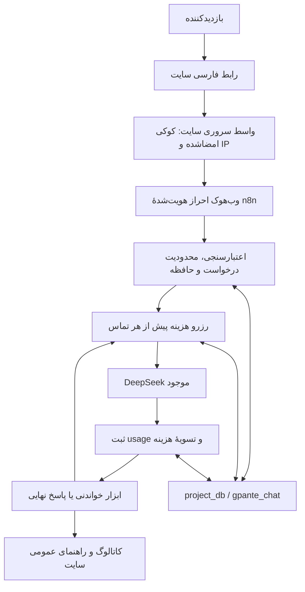

# دستیار پشتیبانی هوش مصنوعی جی‌پانته

[دریافت نسخه‌های افزونهٔ وردپرس](https://github.com/vahid162/n8n-chat-gpante.com/releases) · [تغییرات نسخه‌ها](CHANGELOG.md) · [قواعد انتشار و ارتقا](docs/wordpress-releases.md)

دستیار فارسی [gpante.com](https://gpante.com) برای پیدا کردن طرح‌های برش لیزر، خواندن مشخصات و قیمت جاری و راهنمایی عمومی خرید و دانلود. هدف، محصول قابل توسعه روی n8n و PostgreSQL موجود است؛ همهٔ محصولات مجاز عمومی در دامنهٔ جست‌وجو قرار دارند و محدودیت ۳۰ یا ۵۰ محصول وجود ندارد.

**وضعیت در ۲۰ اکتبر ۲۰۲۶:** افزونهٔ **۰٫۳٫۰** از Release رسمی روی gpante.com نصب و چت برای همهٔ بازدیدکنندگان فعال است. آرشیو مدیریتی ۳۰روزه، مدت نمایش قابل تنظیم ۳/۷/۱۵/۳۰ روز و کنترل پاک‌کردن کاربر اجرا و روی سایت واقعی بررسی شدند. مسیر مدیر: **چت پانته ← گفتگوها**. [راهنمای آرشیو](docs/conversation-archive.md) · [شواهد](specs/002-conversation-archive/verification.md).

تنظیمات ظاهر در نسخهٔ **۰٫۳٫۰** روی سایت فعال‌اند: «چت پانته ← ظاهر» برای تغییر متن‌ها، خوشامد و رنگ‌ها با حفظ اتصال و تاریخچه. [راهنمای ظاهر](integration/wordpress/README.md#ظاهر-030). [شواهد ظاهر و نصب](specs/003-chat-appearance/verification.md).

منبع نسخهٔ **۰٫۴٫۰** چهار لینک اختیاری در تنظیمات ظاهر، ارسال داخل کادر، focus ملایم و بستن با Back/کلیک بیرون را اضافه می‌کند. اندازهٔ پنجره حفظ شده است؛ [جزئیات و شواهد](specs/004-widget-composer-shortcuts/).

## دستیار چه کاری انجام می‌دهد؟

- موضوع، فرمت، ضخامت و متریال را با هم جست‌وجو می‌کند؛ مثلاً «باکس آجیل MDF، ضخامت ۲٫۷، فرمت DXF».
- برای «ارزان‌ترش را داری؟» شرایط همان گفتگو را نگه می‌دارد و ترتیب قیمت را از منبع درخواست می‌کند.
- مشخصات و قیمت را از دادهٔ جاری می‌خواند؛ ویژگی ناموجود را حدس نمی‌زند. قیمت صفر معتبر و واحد پول از منبع است.
- مقاله‌ها و صفحات عمومی قوانین و تماس را با لینک منبع ارائه می‌کند.
- نبود نتیجه، شکست ارتباط و اطلاعات ناقص را جدا می‌کند؛ بدون اجازهٔ کاربر فیلترها را حذف نمی‌کند.

پاسخ هر صفحه حداکثر پنج محصول است؛ این اندازهٔ نمایش است، نه سقف کاتالوگ. تعداد کل، صفحه و وجود ادامه در خروجی ابزار باقی می‌مانند. پوشش کامل منبع با کیفیت جست‌وجوی معنایی یکی نیست؛ embeddings یا سرویس تازه فقط در صورت مشاهدهٔ نیاز اضافه می‌شود.

## اجزای پروژه

| جزء | وضعیت و نقش |
| --- | --- |
| Main در n8n | ورک‌فلوی اصلی گفتگو؛ وضعیت و نسخهٔ فعال در هر عملیات از سرویس خوانده می‌شود |
| DeepSeek موجود | همان اتصال انتخاب‌شدهٔ کاربر؛ فراخوانی از HTTP Request بومی با Credentials سروری |
| PostgreSQL پروژه‌ها | حافظه، محدودیت درخواست و دفتر هزینه فقط در `project_db.gpante_chat` |
| دیتابیس داخلی n8n | فقط امور خود n8n؛ schema چت در آن ایجاد نشده |
| Admin در n8n | مدیریت خصوصی آرشیو/سیاست، با کلید مستقل و بدون تماس مدل |
| Retention در n8n | پاک‌سازی ساعتی؛ اجرای طبیعی زمان‌بندی نیز مشاهده شد |
| افزونهٔ وردپرس | [GPante Support Chat 0.3.0](wordpress-plugin/gpante-support-chat/readme.txt)، تنظیم امن و رابط عمومی؛ روی سایت واقعی بررسی شده |
| مهارت نگهداری | [operate-gpante-support-chat](.agents/skills/operate-gpante-support-chat/SKILL.md)، نسخهٔ ۰٫۷٫۰؛ منبع canonical در همین مخزن |

سامانهٔ جداگانهٔ `woo2` برای انتشار محصول است. چت عمومی به ابزارهای مدیریت، تلگرام، Nextcloud، بارگذاری فایل یا state آن سامانه متصل نیست.

رابط خودکار در افزونه است؛ خروجی اختیاری HTML/CSS/JavaScript وودمارت نیز از همان template و assetها تولید می‌شود. نمایش موردنظر برای همهٔ بازدیدکنندگان است؛ کد رابط به‌تنهایی جای واسط سروری و فعال‌کردن Main را نمی‌گیرد.

## معماری نسخهٔ ۱٫۲



مدل URL، SQL یا کد دلخواه نمی‌دهد. فقط نام ابزار و پارامترهای محدود را درخواست می‌کند. مقصدها، شرایط عمومی‌بودن و پاک‌سازی خروجی در کد تعیین می‌شوند. حداکثر چهار تماس مدل و سه ابزار ترتیبی در هر پیام قابل اجراست؛ تماس آخر فقط پاسخ می‌دهد. هر تماس retry خودکار ندارد.

نسخهٔ اولیه از Agent بومی استفاده می‌کرد و آزمون واقعی آن موفق بود. مسیر HTTP بومی برای دسترسی روشن به `usage` هر تماس و اعمال بودجه انتخاب شد؛ کلید موجود خوانده یا عوض نشده است. مدل، ابزارها، رابط و حافظه منابع جدا دارند تا تغییر آینده محدود بماند.

## هزینه و ظرفیت

بودجهٔ تأییدشده **۲ دلار آمریکا در هر ماه تقویمی UTC برای همین پروژه** است. این سقف، مصرف پروژه‌های دیگر با کلید مشترک DeepSeek را محدود نمی‌کند.

قبل از هر تماس، ۰٫۳۲ دلار به‌صورت اتمی رزرو می‌شود. این رقم از بیش‌برآورد کل context مدل و سقف خروجی ۱۵۳۶ توکن با تعرفهٔ اوج ۱۹ اکتبر محاسبه شده است. پس از پاسخ معتبر، هزینه از `prompt_tokens` و `completion_tokens` با نرخ اوج بدون تخفیف cache ثبت و مازاد رزرو آزاد می‌شود. timeout یا usage نامشخص، رزرو را نگه می‌دارد؛ انقضای درخواست پول را آزاد نمی‌کند. محاسبه در دیتابیس با عدد صحیح نانودلار است.

اگر کمتر از ۰٫۳۲ دلار باقی بماند، تماس تازه پذیرفته نمی‌شود؛ بنابراین ممکن است بخشی از دو دلار استفاده نشود. این دفتر هزینه محافظه‌کارانه است و لزوماً برابر صورتحساب تخفیف‌دار ارائه‌دهنده نیست. [تعرفهٔ رسمی DeepSeek](https://api-docs.deepseek.com/quick_start/pricing/) باید پیش از تمدید اعتبار نرخ دوباره بررسی شود؛ اعتبار فعلی نرخ تا ۱۸ نوامبر ۲۰۲۶ است و پس از آن تماس تازه متوقف می‌شود.

پیش‌فرض ظرفیت تا زمان اندازه‌گیری ترافیک واقعی: دو درخواست هم‌زمان سراسری، یک درخواست فعال برای هر نشست، شش پیام در دقیقه برای هر شناسهٔ IP و ۳۰ عملیات در دقیقه برای همان شناسه. این‌ها ظرفیت تضمین‌شده یا تعداد کاربر برآوردشده نیستند. پیام حداکثر ۴۰۰۰ نویسه و اجرای ورک‌فلو حداکثر ۱۵۰ ثانیه است.

## گفتگو، حریم خصوصی و اعتماد

- در نسخهٔ 0.2.0 مدت نمایش کاربر را مدیر برای همه ۳، ۷، ۱۵ یا ۳۰ روز تعیین می‌کند؛ آرشیو مدیر مستقل ۳۰ روز است. حداکثر شش نوبت قابل دسترس اخیر وارد زمینهٔ مدل می‌شود.
- پاک‌سازی ساعتی منتشر شده است؛ در شرایط عادی حذف فیزیکی می‌تواند تا یک ساعت پس از انقضا انجام شود. حذف پیام مصنوعی منقضی، حفظ پیام جدید و اجرای طبیعی زمان‌بندی بررسی شدند.
- پاک‌کردن کاربر دسترسی و زمینهٔ قبلی را می‌بندد؛ آرشیو مدیر را حذف نمی‌کند. مدیر می‌تواند دکمه و مجوز آن را خاموش کند. [راهنمای آرشیو](docs/conversation-archive.md).
- نشست مرورگر باید از کوکی امضاشدهٔ HttpOnly/Secure/SameSite ساخته شود؛ شناسهٔ دلخواه مرورگر مجوز خواندن گفتگو نیست.
- IP از سرور سایت گرفته و با HMAC تبدیل می‌شود. مسیر واقعی HTTPS و `REMOTE_ADDR` بررسی شدند؛ هدر دلخواه مرورگر معتبر نیست. تغییر پراکسی یا CDN به بررسی دوباره نیاز دارد.
- مرورگر کلید n8n را نمی‌گیرد. CORS جای احراز هویت یا محدودیت مصرف نیست.
- محتوای اجرای خام Main و Admin ذخیره نمی‌شود. Retention فقط دادهٔ نگهداری شامل زمان اجرا و تعداد حذف را برمی‌گرداند و اجرای تولید آن برای پیگیری نتیجه/خطا ذخیره می‌شود. تاریخچهٔ کاربردی در دیتابیس پروژه‌هاست.
- فایل‌های خصوصی، لینک دانلود فروشی، اطلاعات مشتری و کلیدها وارد مخزن عمومی یا خروجی ابزار نمی‌شوند.

## منبع کاتالوگ

در بررسی تولید، هر ۱۰۸۱ محصول عمومی موجود در ۲۱۷ صفحه از provider خوانده و با query عمومی منبع تطبیق داده شد؛ تکرار یا جاافتادگی مشاهده نشد. این شمار مربوط به زمان بررسی است و سقف یا شمار ثابت آینده نیست.

کد نسخهٔ ۱٫۱ دو مسیر محدود `gpante-support/v1/products` و `gpante-support/v1/knowledge` را برای اجرای سروری در سایت آماده می‌کند. محصول باید منتشرشده، بدون رمز و مجاز برای نمایش در کاتالوگ یا جست‌وجو باشد؛ visible، catalog-only و search-only پذیرفته می‌شوند و hidden/خصوصی/رمزدار رد می‌شوند. خواندن مستقیم جزئیات نیز همین شرایط را رعایت می‌کند. API قدیمی به‌تنهایی شاهد کافی برای حذف همهٔ موارد رمزدار نبود.

ویژگی‌های ساختاریافتهٔ WooCommerce شامل `pa_file-format`، `pa_thickness` و `pa_materials-required` هستند. اعداد و حروف فارسی/عربی یکسان می‌شوند. مترادف کنترل‌شدهٔ جعبه/باکس و term واقعی «MDF یا پلکسی» پشتیبانی می‌شوند؛ «MDF و پلکسی» خودکار به MDF ساده تبدیل نمی‌شود. ترتیب قیمت از lookup بومی WooCommerce درخواست می‌شود.

provider روی WooCommerce واقعی بررسی شد؛ قیمت، فیلتر هم‌زمان، صفحهٔ آخر و صفحهٔ خارج از محدوده آزموده شدند. نسخهٔ ۰٫۱٫۱ شکل stdClass ویژگی‌ها و تصاویر WooCommerce را نیز پیش از انتخاب فیلدهای عمومی می‌پذیرد. در نبود منبع، ورک‌فلو باید ناتوانی خواندن را اعلام کند؛ محصول یا سیاست خرید اختراع نمی‌کند.

## ساخت و بررسی برای توسعه‌دهنده

- `src/catalog.cjs`: قرارداد و پاک‌سازی ابزارهای عمومی.
- `src/chat.cjs` و `src/system-message.txt`: کنترل گفتگو، تماس مدل و دستورهای دستیار.
- `scripts/build-workflow.cjs`: ساخت قطعی JSONهای `workflows/`؛ بدون شناسهٔ استقرار، اتصال یا کلید خصوصی.
- `sql/chat.sql`: migration اولیه؛ روی schema موجود دوباره اجرا نشود.
- `sql/002-public-chat.sql`: ارتقای کنترل بودجه و نگهداری؛ یک‌بار پس از migration اولیه.
- `tests/database.sql`: بررسی تراکنشی با rollback؛ فقط وقتی Main غیرفعال است اجرا شود.

```sh
node --test tests/*.test.cjs
node scripts/build-workflow.cjs
php tests/plugin-settings.php
php -l wordpress-plugin/gpante-support-chat/includes/bridge.php
php -l wordpress-plugin/gpante-support-chat/includes/catalog.php
python3 scripts/build-plugin.py
php tests/widget-bridge.php
php tests/catalog-query.php
```

اعتبارسنج `scripts/validate-native.cjs` باید با Node و وابستگی‌های n8n نصب‌شده و یک کپی خصوصیِ دارای اتصال اجرا شود. فایل عمومی عمداً Credentials ندارد. نتیجهٔ exit code به‌تنهایی موفقیت اجرای CLI را ثابت نمی‌کند؛ `status` و خطاهای نتیجه نیز بررسی شوند.

آزمون‌های پیشین، ادامهٔ مکالمه، جداسازی نشست و اعلام خطای منبع را پوشش دادند. در راه‌اندازی تولید نیز پرسش محصول از سایت تا مدل با داده و قیمت واقعی بررسی شد. مصرف و رسیدهای اجرای مدل خصوصی نگهداری می‌شوند؛ نتیجهٔ چند سناریو تضمین سرعت یا آزمون بار نیست.

آزمون جاری شامل ۴۰ تست Node، تنظیمات/مهاجرت PHP، پل سروری و ۱۰ حالت query/Schema است؛ پنج آزمون بسته/انتشار و WPCS نیز موفق‌اند. [گزارش محلی افزونه](specs/001-wordpress-plugin-basic/verification.md) و [گزارش سایت واقعی](docs/production-readiness.md) محدوده‌ها را جدا ثبت می‌کنند. رزرو هم‌زمان در مرز بودجه و جداسازی ماه نیز بدون تماس مدل بررسی شد؛ `tests/money-concurrency.py` فقط هنگام غیرفعال‌بودن Main و با کاربر نگهداری دیتابیس اجرا شود. گراف کامل چهار دور/سه ابزار با پاسخ‌های مصنوعی شبکه و PostgreSQL واقعی بررسی شده است.

## مسیر تکمیل و توسعهٔ بعدی

ساخت افزونه، انتشار ZIP، اتصال تولید و بررسی کاتالوگ/رابط واقعی انجام شدند. مرحلهٔ بعد، بررسی کیفیت پاسخ، خطا و مصرف در استفادهٔ واقعی است؛ تغییر PHP، وب‌سرور، پراکسی یا تنظیمات پنل باید با بررسی دوبارهٔ timeout، cache و هویت شبکه همراه باشد. روش ارتقا و بررسی در [گزارش تولید](docs/production-readiness.md) آمده است.

بعد از هستهٔ عمومی می‌توان پیگیری سفارش، دانلود خریداری‌شده و ارجاع انسانی را با احراز هویت واقعی مشتری و کنترل مالکیت اضافه کرد. این نسخه به حساب، سفارش یا دانلود اختصاصی مشتری دسترسی ندارد و اقدام مالی یا تغییر سفارش انجام نمی‌دهد.

برای ادامهٔ کار، [AGENTS.md](AGENTS.md) و [مهارت اختصاصی](.agents/skills/operate-gpante-support-chat/SKILL.md) را بخوانید. [وضعیت جاری](.agents/skills/operate-gpante-support-chat/references/project-state.md) نسخهٔ واقعی n8n، نتیجهٔ بررسی‌ها و کار بعدی را ثبت می‌کند؛ Git تاریخچهٔ تغییرات است. هیچ نسخهٔ عمومی جای پشتیبان خصوصیِ قابل بازیابی و بازخوانی وضعیت زنده را نمی‌گیرد.

## ساخت و ارتقای افزونهٔ وردپرس

منبع واحد PHP، template و assetها در `wordpress-plugin/gpante-support-chat/` است. `python3 scripts/build-plugin.py` فقط runtime را ZIP می‌کند؛ به بستهٔ Codex skill ارتباطی ندارد. [راهنمای فارسی نصب، تنظیم و ارتقا](integration/wordpress/README.md) و [نیاز/برنامه/کارهای Spec Kit](specs/001-wordpress-plugin-basic/spec.md) همراه کد نگهداری می‌شوند. تنظیمات با Settings API و schema مستقل حفظ می‌شوند؛ چارچوب، جدول، سرویس یا updater سفارشی اضافه نشده است.

برای نصب، ZIP افزونه را از Assets همان Release دانلود کنید؛ Source code ZIP بستهٔ نصب وردپرس نیست. تگ‌های افزونه قالب `wordpress-vX.Y.Z` دارند و فایل `SHA256SUMS` همراه هر انتشار است.
